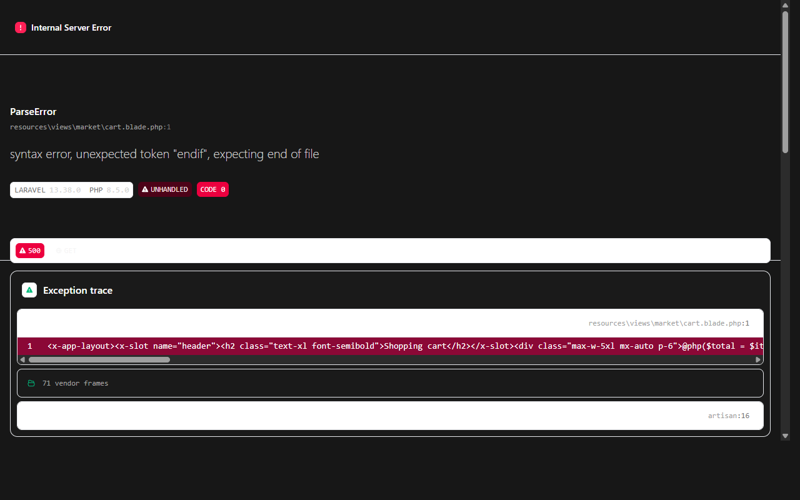

# Online Food Delivery Laravel

Standalone Laravel 13 marketplace for a small food-delivery operation. Restaurant-specific menus and carts; addresses; server-calculated checkout; stock/promotion transactions; customer order history; restaurant and delivery operations; COD; admin reporting.

## Setup (Windows PowerShell)

```powershell
Copy-Item .env.example .env
composer install
npm ci
php artisan key:generate
php artisan migrate --seed
php artisan storage:link
npm run build
php artisan serve
```

Register a personal account through the app. **Public sign-up only creates customer accounts.** Initial administrator and other privileged roles must be granted through trusted console access; there are no seeded accounts/passwords. Use `php artisan tinker` and substitute an existing account email:

```php
App\Models\User::where('email', 'your-admin@example.test')->firstOrFail()->forceFill(['role' => 'admin'])->save();
```

The administrator can create a restaurant and assign its already-registered owner account. Before that, promote the account to `restaurant` using trusted Tinker. Promote delivery accounts to `delivery` in the same way. Never add role assignment to public registration or expose Tinker in production.

## Features

- Public storefront, restaurant menus, optional JPEG/PNG/WebP menu images (3 MB maximum).
- Authenticated cart limited to one restaurant, 30 distinct items, 20 units per item.
- Customer-owned delivery addresses; checkout snapshots address and item prices/names.
- Checkout recalculates all prices, fees, stock, and promotions from locked database rows; unique order reference; inventory decrement and promotion redemption commit atomically.
- Percentage or fixed-value promotions with schedule, minimum subtotal, and optional use limit.
- Restaurant owners manage opening state, delivery fees, categories, menu entries, availability, stock, and incoming-order status.
- Admin creates restaurants/promotions, assigns drivers, and reviews gross order totals by status.
- Delivery staff only see assigned orders; transitions `ready → picked_up → delivered`. Completing delivery marks COD paid. Rejected/cancelled orders restore remaining item stock.
- Customers see only their orders; other unauthorized order lookups return 404. Order status changes and snapshots remain auditable.

## Status / payment limitations

Payment is **cash on delivery only**; there is no card gateway, refund flow, delivery tracking/GPS, restaurant discovery by distance, tax engine, email/SMS notification, real-time push, ratings, or multi-restaurant checkout. The assigned delivery worker marks COD collected by completing delivery; this is a lightweight workflow, not payment-provider reconciliation. Promotions can be created and used, but this demo has no promotion-disable/delete UI. Customer cancellation UI is omitted.

Inventory/order atomicity depends on row-level locking. Use PostgreSQL or MySQL for production concurrency; SQLite is for local development and tests only. Configure backups, HTTPS, database isolation, rate limiting, storage access, monitoring, privacy/retention, and managed role administration before launch. Public menu images use Laravel's public disk; `php artisan storage:link` is required.

No sample users or personal records are seeded. The seeder is intentionally empty to avoid publishing demo credentials or plausible real-looking contact information.

## Validation

```powershell
php artisan route:list
php artisan migrate:fresh --seed
php artisan test --compact
php artisan view:cache
npm run build
composer validate --no-check-publish
composer audit
npm audit --omit=dev
```

`npm audit --omit=dev` reports 0 vulnerabilities. Full `npm audit` reports 3 moderate development-tool findings (`postcss-nested`, `postcss-selector-parser`, Tailwind CSS); npm suggests Tailwind 4.3.3, a breaking major upgrade. Do not run `npm audit fix --force` blindly; assess a deliberate Tailwind v4 migration separately. `.env`, SQLite files, `vendor`, `node_modules`, framework caches, and build artifacts are excluded from Git.


## Screenshots

### Dashboard Overview


### Login Overview


### Cart Overview

